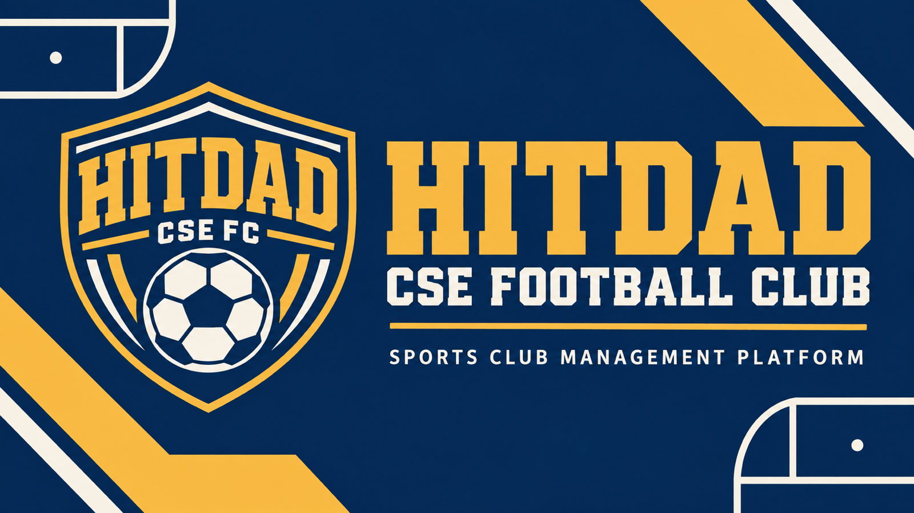

# CSE HitDad

Dự án môn **Phát triển ứng dụng di động** của nhóm **Hiền và nhiều tài**.

HitDad hướng tới hỗ trợ chủ kèo và thành viên câu lạc bộ bóng đá nội bộ
phối hợp tổ chức trận đấu: đăng ký tham gia, điểm danh, chia đội và theo dõi
chi phí/thanh toán. Đây là hướng sản phẩm đang được nghiên cứu; phạm vi MVP
sẽ được xác định dựa trên bằng chứng và quyết định sản phẩm của nhóm.

## Tài liệu và kế hoạch

| Tài nguyên | Nội dung |
|---|---|
| [GitHub Wiki](https://github.com/HitDad/HitDad/wiki) | Báo cáo Assignment 1 và mục lục tài liệu sản phẩm |
| [GitHub Organization](https://github.com/HitDad) | Không gian cộng tác của nhóm |
| [GitHub Project](https://github.com/orgs/HitDad/projects/1) | Công việc, người phụ trách, trạng thái và tiến độ |
| [Issues](https://github.com/HitDad/HitDad/issues) | Phân công, checklist bàn giao và trao đổi review |
| [Milestones](https://github.com/HitDad/HitDad/milestones) | Các mốc hoàn thành công việc |

## Assignment 1 — Product Discovery & Foundation

Tài liệu đang được nhóm xây dựng trên Wiki, gồm:

1. Project Direction.
2. Mobile Product Rationale.
3. Critical Assumptions.
4. Evidence Plan.
5. User / Market Research.
6. Existing Solutions & Alternatives.
7. Evidence Evaluation & Product Decisions.
8. Business Canvas.
9. Impact–Effort Matrix.
10. MVP Scope.
11. User Stories.
12. Critical User Flows.
13. Project Plan.

Các phần được liên kết để thể hiện lập luận:

**Evidence → User Need → Requirement → User Story → MVP Feature → User Flow → Development Task.**

## Nhóm và phân công

Nhóm gồm 5 thành viên. Tên và GitHub của các thành viên còn thiếu sẽ được
cập nhật khi hoàn tất phân công và tham gia Organization.

| Vai trò / Gói | Thành viên | Phụ trách |
|---|---|---|
| Nhóm trưởng | Nguyễn Bảo Thiên | Nền tảng GitHub, điều phối, review, tích hợp và nộp bài |
| A — TV1 | Vũ Đức Thắng | Direction, assumptions, evidence plan, product decisions và traceability |
| B — TV2 | Nguyễn Tăng Vũ | Pilot evidence, user / market research, findings và limitations |
| C — TV3 | Phạm Xuân Vũ | Alternatives, mobile rationale và Business Canvas |
| D — TV4 | Tôn Văn Gia Bảo | Impact–Effort Matrix, MVP, stories, flows và Project Plan |

## Bằng chứng nghiên cứu và tài liệu hỗ trợ

Danh mục evidence và liên kết tới dữ liệu/tài liệu hỗ trợ đang được tổng hợp
trong phần **User / Market Research**, truy cập từ
[mục lục Wiki](https://github.com/HitDad/HitDad/wiki).
Link trực tiếp tới danh mục evidence sẽ được bổ sung khi có bản bàn giao.

Theo thông tin nhóm cung cấp, pilot web đã mở vote cho **5 session** và có
**2 trận đã diễn ra**. Số liệu chi tiết, phương pháp và giới hạn của bằng chứng
cần được đối chiếu trong báo cáo nghiên cứu; đây chưa phải kết luận xác thực
toàn bộ hướng sản phẩm mobile.

Web demo có trước phục vụ tham khảo và nghiên cứu ban đầu:
[CSE_HitDad](https://hitdad.vercel.app).

## Cách cộng tác

- Nhận việc qua Issue và cập nhật trạng thái trên Project:
  **Backlog → To Do → In Progress → Review → Done**.
- Cập nhật nội dung trên Wiki, gắn link đầu ra và bằng chứng vào Issue tương ứng.
- Với thay đổi trong repository, tạo branch và Pull Request để review.
- Chuyển sang Review khi có bản bàn giao; chỉ đánh dấu Done sau khi đã xử lý
  nhận xét và được nhóm trưởng xác nhận.

## Trạng thái hiện tại

Dự án đang trong giai đoạn khám phá sản phẩm và xây dựng nền tảng cho
Assignment 1. Tài liệu, phân công thành viên và danh mục evidence đang được
hoàn thiện. Tiến độ chi tiết được cập nhật trên GitHub Project và Issues.
