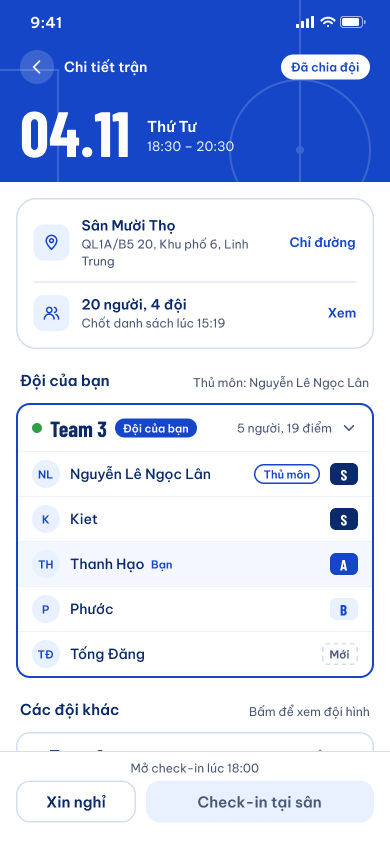
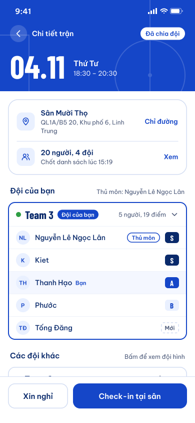
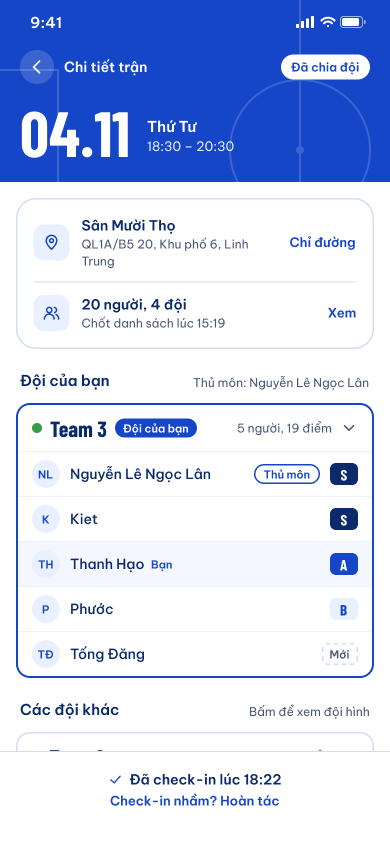
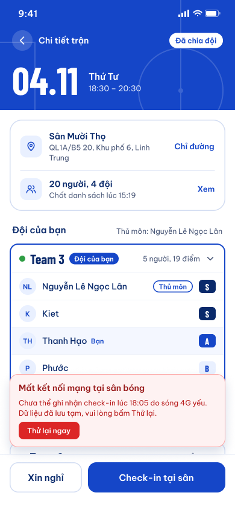

# Báo cáo Kiểm thử Khả năng Sử dụng & Cải tiến Thiết kế (Usability Testing & Design Iteration)

> **Bài tập lớn môn Phát triển ứng dụng cho thiết bị di động (CO3043)** — Nhóm **L02_Hiền và nhiều tài**.
>
> **Liên kết liên quan:** [Trang chủ GitHub Wiki](https://github.com/HitDad/HitDad/wiki) · [Assignment 2 — Tổng hợp Thiết kế & MVP](https://github.com/HitDad/HitDad/wiki/Assignment-2-Product-Design-Prototyping-and-Validation) · [Figma Interactive Prototype](https://www.figma.com/proto/fGXYmJMlxPStGfv1ouUuDe/Figma-HitDad?node-id=1-274&scaling=scale-down&content-scaling=fixed&starting-point-node-id=1%3A274) · [Behance Case Study](https://www.behance.net/gallery/258941175/CSE-HitDad-Mobile-App-for-Football-Club-Coordination) · [Product Landing Page](https://cse-hitdad.vercel.app)

> *Tài liệu này lưu trữ tách riêng toàn bộ kịch bản kiểm thử, dữ liệu quan sát thực tế từ người dùng ngoài nhóm (`P01–P03`) và bằng chứng cải tiến thiết kế (`Before → After`) cho **Mục 3.5 — Assignment 2**, tách biệt khỏi phần giới thiệu dự án trên GitHub Wiki.*

---

## 1. Kịch bản kiểm thử & Bộ tác vụ đại diện (Representative Tasks)

- **Công cụ sử dụng:** [Figma Interactive Prototype](https://www.figma.com/proto/fGXYmJMlxPStGfv1ouUuDe/Figma-HitDad?node-id=1-274&scaling=scale-down&content-scaling=fixed&starting-point-node-id=1%3A274).
- **Quy tắc thực hiện:** Người điều phối chỉ đọc bối cảnh tình huống, **không gợi ý nút cần bấm**, quan sát thao tác tự nhiên, ghi nhận điểm bị khựng/nhầm lẫn và hỏi lý do sau khi kết thúc tác vụ. Danh tính người tham gia được ẩn danh (`P01`, `P02`, `P03`) để đảm bảo quyền riêng tư.

| Mã Task | Bối cảnh & Yêu cầu giao cho người test | Starting Point trên Figma | Điều kiện hoàn thành (Success Criteria) | Điểm cần quan sát |
| :--- | :--- | :--- | :--- | :--- |
| **UT-01** | *"CLB vừa mở kèo đá tối thứ Tư 04/11. Hãy xem thông tin sân, kiểm tra giờ nào đang nhiều người chọn nhất và xác nhận tham gia (hoặc báo không đi được kèm lý do)."* | `Flow 2: Lịch đá & Vote kèo` (`01 Lịch đá`) | Mở được `02 Chi tiết trận`, đọc được số phiếu từng khung giờ, bấm được `Tham gia` hoặc hoàn thành overlay chọn lý do. | Có tìm ra nút vào chi tiết trận và thanh tiến độ phiếu vote không? Có thấy chip chọn lý do nhanh không? |
| **UT-02** | *"Đã có đội hình chính thức và tới giờ đá tại Sân Mười Thọ. Hãy kiểm tra bạn đá ở Team nào, ai là thủ môn đội bạn, rồi thực hiện Check-in tại sân. Nếu lỡ bấm nhầm hoặc mạng yếu thì xử lý thế nào?"* | `Flow 3: Chia đội & Check-in tại sân` (`02f-1` → `02f-2`) | Đọc đúng tên đội (`Team 3`) và thủ môn (`Nguyễn Lê Ngọc Lân`), bấm chuyển sang mở Check-in, bấm `Check-in tại sân` sang `02f-3`, biết cách bấm `Hoàn tác` hoặc `Thử lại ngay` ở màn lỗi `02f-err`. | Có nhận ra trạng thái nút `Chưa mở` vs `Đang mở` không? Có dễ thấy liên kết `Hoàn tác` và nút `Thử lại ngay` không? |
| **UT-03** | *"Sau khi đội đã chia xong thì bạn đột xuất có việc bận không ra sân được. Hãy gửi yêu cầu xin nghỉ cho admin."* | `02f-2` | Bấm nút `Xin nghỉ`, hiểu cảnh báo vẫn tính tiền trước khi admin duyệt, chọn lý do và bấm gửi yêu cầu. | Có phân biệt được `Không tham gia` (trước khi chốt) và `Xin nghỉ` (sau khi chia đội) không? |
| **UT-04** | *"Trận 28/10 đã đá xong. Hãy kiểm tra phần tiền bạn phải đóng được tính như thế nào và thực hiện chuyển khoản qua VietQR."* | `Flow 4: Chốt bill & VietQR` (`03 Thanh toán` hoặc `02g`) | Đọc đúng công thức (`900k + 150k ÷ 21 = 50.000đ`), tìm thấy nút copy nội dung chuyển khoản `HITDAD 2810 THANG` và trạng thái chờ xác nhận. | Có tin tưởng cách chia tiền không? Có thắc mắc gì về nút `Mở app ngân hàng` không? |

---

## 2. Kết quả kiểm thử với 3 người dùng đại diện ngoài nhóm

| Mã người test (Ẩn danh) | Hồ sơ đối tượng | Ngày test & Công cụ | UT-01 (Vote/Báo vắng) | UT-02 (Xem đội & Check-in) | UT-03 (Xin nghỉ) | UT-04 (VietQR & Bill) | Vấn đề Usability / Phản hồi quan sát được |
| :--- | :--- | :--- | :--- | :--- | :--- | :--- | :--- |
| **P01** | Sinh viên IU năm cuối, thành viên CLB | 20/11/2026 · Figma Prototype | Hoàn thành | Khựng | Hoàn thành | Hoàn thành | Người dùng thắc mắc trên giao diện lúc test chưa thấy cho phép thành viên tự check-in tại sân. |
| **P02** | Sinh viên CSE năm 2 | 20/11/2026 · Figma Prototype | Hoàn thành | Khựng | Hoàn thành | Hoàn thành | Góp ý việc user chưa có quyền tự check-in trên luồng prototype và chưa thấy xử lý các trường hợp sự cố trên UI (ví dụ lỗi mạng tại sân). |
| **P03** | Từng đứng ra thanh toán tiền sân cho CLB | 21/11/2026 · Figma Prototype | Hoàn thành | Hoàn thành | Hoàn thành | Hoàn thành | Đánh giá cao tính tiện lợi của app vì giải quyết được vấn đề phải nhớ và đòi tiền sân từng người. |

---

## 3. Các cải tiến thiết kế dựa trên bằng chứng kiểm thử (`Before → After`)

### 3.1. Cải tiến trực tiếp từ góp ý của `P01` & `P02` (`UT-02`: Luồng Check-in tại sân & Khôi phục lỗi mạng)
- **Vấn đề phát hiện:** Khi thử nghiệm `UT-02` trên bản thiết kế đầu, cả `P01` và `P02` đều bị khựng vì thanh đáy ở màn chi tiết trận sau khi chia đội chỉ hiển thị trạng thái bị khóa (*"Mở check-in lúc 18:00"*), khiến thành viên không thấy cách tự check-in tại sân; đồng thời `P02` chỉ ra UI chưa thể hiện cách xử lý khi rớt mạng lúc thao tác.
- **Thay đổi trên Figma (`Before → After`):**
  - Bổ sung màn hình **`02f-2 Chi tiết trận – Đang mở Check-in`** với nút chính `#1546C8` **`Check-in tại sân`** ở vùng ngón cái.
  - Bổ sung màn hình **`02f-3 Chi tiết trận – Đã Check-in tại sân`** hiển thị mốc thời gian `18:22` và đường dẫn **`Check-in nhầm? Hoàn tác`** để quay lại `02f-2`.
  - Bổ sung màn hình **`02f-err Chi tiết trận – Lỗi mạng khi Check-in`** hiển thị thẻ cảnh báo mất kết nối 4G tại sân bóng (giữ dữ liệu lưu tạm) kèm nút **`Thử lại ngay`**.
  - Nối đầy đủ dây tương tác Prototype cho cả luồng `02f-1 → 02f-2 → 02f-err → 02f-3`.
- **Kết quả sau chỉnh sửa:** Sau khi bổ sung và trình bày lại, cả `P01` và `P02` đều xác nhận luồng tự check-in và xử lý sự cố mạng đã đúng với kỳ vọng sử dụng thực tế tại sân.

| Before (Bản test `P01–P02`) | After 1 · Mở Check-in (`02f-2`) | After 2 · Đã Check-in & Hoàn tác (`02f-3`) | After 3 · Khôi phục mất mạng (`02f-err`) |
| :---: | :---: | :---: | :---: |
|  |  |  |  |
| Nút `Check-in tại sân` bị khóa (*"Mở check-in lúc 18:00"*), chưa có đường đi tiếp và chưa có xử lý sự cố mạng. | Kích hoạt nút chính `#1546C8` `Check-in tại sân` ở vùng ngón cái. | Ghi nhận giờ check-in (`18:22`) kèm liên kết `Check-in nhầm? Hoàn tác`. | Lưu tạm dữ liệu khi mất mạng 4G ngoài sân và cho bấm `Thử lại ngay`. |

### 3.2. Các cải tiến hoàn thiện trạng thái hệ thống khác (`00a-err`, `09b`)
- **Xác thực đăng nhập (`00a-err`):** Bổ sung trạng thái nhập sai mật khẩu với viền đỏ ở ô nhập và thông báo số lần thử còn lại.
- **Trạng thái trống thông báo (`09b`):** Sau khi bấm `Đọc hết`, đồng bộ hiển thị `0 chưa đọc`, chip `Chưa đọc 0` và thẻ Empty State giải thích rõ các loại thông báo sẽ xuất hiện.
