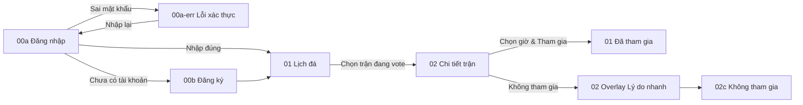
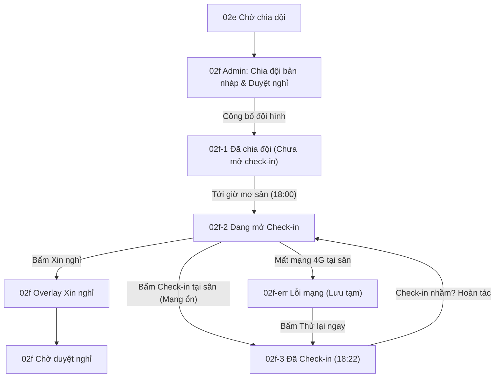
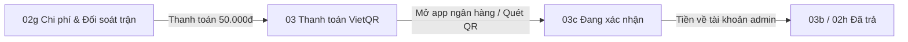
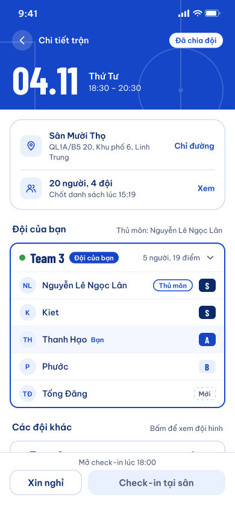
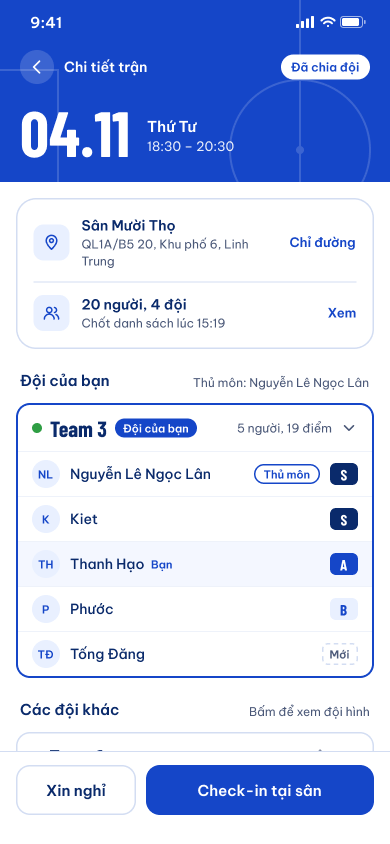
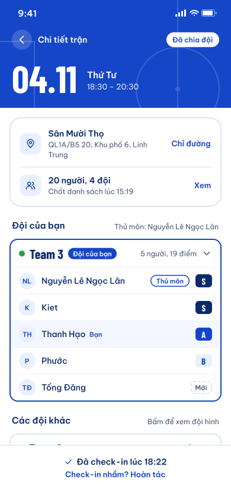
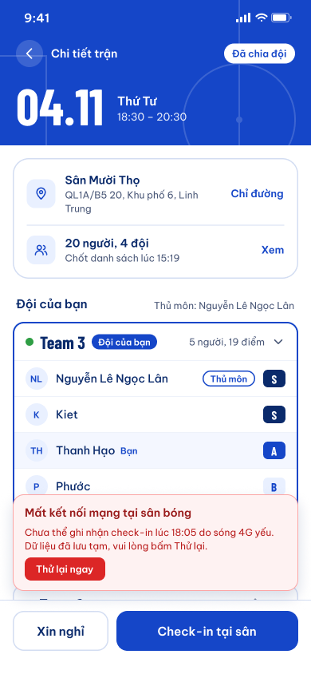

# Assignment 2 — Product Design, Prototyping & Validation

> **Liên kết nhanh:** [Trang chủ Wiki](Home) · [Figma Design](https://www.figma.com/design/fGXYmJMlxPStGfv1ouUuDe/Figma-HitDad--Copy-?node-id=1-273) · [Interactive Prototype](https://www.figma.com/proto/fGXYmJMlxPStGfv1ouUuDe/Figma-HitDad--Copy-?node-id=1-273&scaling=scale-down&content-scaling=fixed&starting-point-node-id=1%3A274) · [Behance Case Study](https://www.behance.net/gallery/258893173/CSE-HitDad-Mobile-App-for-Football-Club-Coordination) · [Product Landing Page](https://cse-hitdad.vercel.app)

---

## Phần 1 · Product Refinement & MVP Alignment

### 1.1. Rà soát bài toán, đối tượng mục tiêu & UVP
- **Problem Statement:** Các câu lạc bộ bóng đá nội bộ (~30–38 thành viên) gặp tình trạng rời rạc xuyên suốt ba giai đoạn trận đấu:
  1. *Trước trận:* Poll bình chọn trên Messenger dễ trôi tin, chủ kèo phải đếm thủ công quân số tham gia và người báo bận.
  2. *Tại sân:* Điểm danh và chia đội cho cân bằng trình độ + thủ môn mất 15–20 phút đầu giờ; xử lý người xin nghỉ sát giờ gây rối đội hình.
  3. *Sau trận:* Chia tiền sân, nước, áo bib dễ nhầm theo số người đi thực tế và chủ kèo ngại nhắc chuyển khoản từng thành viên.
- **Target Users:**
  1. **Chủ kèo / Ban cán sự CLB (Organizer/Admin):** Tạo kèo, chốt giờ, sắp đội hình, duyệt xin nghỉ và đối soát thanh toán.
  2. **Thành viên CLB (Player/Member):** Sinh viên và cựu sinh viên tham gia đá giao lưu định kỳ hàng tuần.
- **Unique Value Proposition (UVP):** Khép kín vòng đời một trận đấu bóng đá CLB (*Vote khung giờ → Chia đội cân bằng → Check-in tại sân → Chốt bill VietQR*) ngay trên di động với thao tác ngắn gọn, giảm gõ phím khi di chuyển và ngoài sân bóng.

### 1.2. Bảng đối chiếu nhất quán MVP ↔ User Flows ↔ Figma Screens

| MVP Feature | Updated User Flow (Figma) | Màn hình đại diện trên Figma | Trạng thái hỗ trợ |
| :--- | :--- | :--- | :--- |
| **F01 · Đăng nhập & Hồ sơ CLB** | Flow 1: Đăng nhập & Xác thực | `00a Đăng nhập`, `00b Đăng ký tài khoản`, `00a-err`, `04 Thành viên CLB`, `05 Tài khoản` | Default, Active, Input Validation Error |
| **F02 · Tạo trận & Vote khung giờ** | Flow 2: Lịch đá, Tạo kèo & Bình chọn giờ | `01 Lịch đá`, `01 Tab Đã đá`, `02 Chi tiết trận`, `02 Overlay – Lý do không tham gia`, `02c Không tham gia`, `06 Tạo trận đấu – Admin` | Default, Voting, Closed, Quick-Select Chips, Empty |
| **F03 · Chia đội & Duyệt xin nghỉ** | Flow 3: Chia đội, Xin nghỉ & Check-in | `02e Chờ chia đội`, `02f Admin – Chia đội (chưa công bố)`, `02f-1 Đã chia đội`, `02f Overlay – Xin nghỉ`, `02f Chờ duyệt nghỉ` | Waiting, Draft (Admin), Published, Pending Leave Approval |
| **F04 · Điểm danh tại sân (Check-in)** | Flow 3: Check-in tại sân & Khôi phục lỗi | `02f-1` (Chưa mở), `02f-2 Đang mở Check-in`, `02f-3 Đã Check-in (Hoàn tác)`, `02f-err Lỗi mạng` | Disabled, Active, Success + Undo, Offline Recovery |
| **F05 · Chia tiền sân & VietQR** | Flow 4: Chốt bill & Thanh toán VietQR | `02g Đã đá – Chờ thanh toán`, `02h Đã trả`, `03 Thanh toán VietQR`, `03c Đang xác nhận`, `03b Đã trả` | Pending Payment, Verifying, Confirmed/Paid |
| **F06 · Thông báo trận đấu** | Flow 5: Quản lý CLB & Thông báo | `01 Lịch đá – Thông báo đẩy`, `09 Thông báo`, `09b Trạng thái trống` | Unread List, Push Preview, Empty State (`0 chưa đọc`) |

### 1.3. Sơ đồ User Flows cập nhật (Đồng bộ với Figma Prototype)

#### Flow 1 & 2 — Đăng nhập, Lịch đá & Bình chọn khung giờ

#### Flow 3 — Chia đội bản nháp, Xin nghỉ & Check-in tại sân (Có xử lý lỗi mạng)

#### Flow 4 — Chốt chi phí & Thanh toán VietQR

### 1.4. Giải thích các thay đổi quan trọng so với Assignment 1 (Justification of Significant Changes)

1. **Bổ sung cơ chế Bản nháp chia đội cho Admin (`02f Admin`) và luồng Xin nghỉ sau khi chia đội (`02f Overlay – Xin nghỉ`, `02f Chờ duyệt nghỉ`):**
   - *Lý do:* Ở Assignment 1 ([12-Critical-User-Flows](12-Critical-User-Flows)), luồng chia đội được mô tả tuyến tính tại sân. Khi rà soát thực tế vận hành kèo, chủ kèo thường chia đội trước giờ bóng lăn để công bố trước cho anh em biết áo bib/thủ môn, nhưng vẫn phát sinh người xin nghỉ đột xuất. Việc tách trạng thái *Bản nháp* và *Yêu cầu xin nghỉ cần duyệt* giúp giữ nguyên sự rõ ràng về trách nhiệm tiền sân cho tới khi chủ kèo xác nhận người thay.
2. **Mở rộng thanh Check-in thành 4 trạng thái (`Chưa mở → Đang mở → Đã check-in có Hoàn tác → Đã khóa`) kèm màn hình Lỗi mạng (`02f-err`):**
   - *Lý do:* Sóng 4G tại nhiều sân bóng ngoài trời thường chập chờn và người dùng dễ bấm nhầm nút khi đang di chuyển. Bổ sung trạng thái tự check-in, `Hoàn tác` và `Offline Recovery (Thử lại ngay)` giúp đảm bảo dữ liệu điểm danh dùng làm căn cứ chia tiền sân không bị sai lệch.
3. **Thay thế việc gõ văn bản dài bằng Quick-Select Chips (`Bận học/thi`, `Ốm/chấn thương`, `Kẹt xe`, `Thời tiết xấu`):**
   - *Lý do:* Tuân thủ nguyên tắc thiết kế Mobile-First (giảm thiểu nhập liệu bàn phím). Thành viên chỉ cần 2 chạm để báo vắng thay vì bỏ qua không phản hồi.
4. **Tách rõ 3 trạng thái thanh toán VietQR (`Chưa trả` → `Đang xác nhận` → `Đã trả`):**
   - *Lý do:* Trong Assignment 1, nhóm đã nhận diện rủi ro nhầm lẫn giữa việc thành viên tự báo đã chuyển khoản và tiền thực sự về tài khoản chủ kèo. Màn hình `03c Đang xác nhận` thông báo rõ *"Đang chờ tiền về tài khoản admin — Thường mất dưới 1 phút"* giúp thành viên yên tâm thoát màn hình mà không chuyển khoản nhầm 2 lần.

---

## Phần 2 · Usability Testing & Design Iteration

### 2.1. Kịch bản kiểm thử & Bộ tác vụ đại diện (Representative Tasks)

- **Công cụ sử dụng:** [Figma Interactive Prototype](https://www.figma.com/proto/fGXYmJMlxPStGfv1ouUuDe/Figma-HitDad--Copy-?node-id=1-273&scaling=scale-down&content-scaling=fixed&starting-point-node-id=1%3A274).
- **Quy tắc thực hiện:** Người điều phối chỉ đọc bối cảnh tình huống, **không gợi ý nút cần bấm**, quan sát thao tác tự nhiên, ghi nhận điểm bị khựng/nhầm lẫn và hỏi lý do sau khi kết thúc tác vụ. Tôn trọng quyền riêng tư bằng cách ẩn danh (`P01`, `P02`, `P03`).

| Mã Task | Bối cảnh & Yêu cầu giao cho người test | Starting Point trên Figma | Điều kiện hoàn thành (Success Criteria) | Điểm cần quan sát |
| :--- | :--- | :--- | :--- | :--- |
| **UT-01** | *"CLB vừa mở kèo đá tối thứ Tư 04/11. Hãy xem thông tin sân, kiểm tra giờ nào đang nhiều người chọn nhất và xác nhận tham gia (hoặc báo không đi được kèm lý do)."* | `Flow 2: Lịch đá & Vote kèo` (`01 Lịch đá`) | Mở được `02 Chi tiết trận`, đọc được số phiếu từng khung giờ, bấm được `Tham gia` hoặc hoàn thành overlay chọn lý do. | Có tìm ra nút vào chi tiết trận và thanh tiến độ phiếu vote không? Có thấy chip chọn lý do nhanh không? |
| **UT-02** | *"Đã có đội hình chính thức và tới giờ đá tại Sân Mười Thọ. Hãy kiểm tra bạn đá ở Team nào, ai là thủ môn đội bạn, rồi thực hiện Check-in tại sân. Nếu lỡ bấm nhầm hoặc mạng yếu thì xử lý thế nào?"* | `Flow 3: Chia đội & Check-in tại sân` (`02f-1` → `02f-2`) | Đọc đúng tên đội (`Team 3`) và thủ môn (`Nguyễn Lê Ngọc Lân`), bấm chuyển sang mở Check-in, bấm `Check-in tại sân` sang `02f-3`, biết cách bấm `Hoàn tác` hoặc `Thử lại ngay` ở màn lỗi `02f-err`. | Có nhận ra trạng thái nút `Chưa mở` vs `Đang mở` không? Có dễ thấy liên kết `Hoàn tác` và nút `Thử lại ngay` không? |
| **UT-03** | *"Sau khi đội đã chia xong thì bạn đột xuất có việc bận không ra sân được. Hãy gửi yêu cầu xin nghỉ cho admin."* | `02f-2` | Bấm nút `Xin nghỉ`, hiểu cảnh báo vẫn tính tiền trước khi admin duyệt, chọn lý do và bấm gửi yêu cầu. | Có phân biệt được `Không tham gia` (trước khi chốt) và `Xin nghỉ` (sau khi chia đội) không? |
| **UT-04** | *"Trận 28/10 đã đá xong. Hãy kiểm tra phần tiền bạn phải đóng được tính như thế nào và thực hiện chuyển khoản qua VietQR."* | `Flow 4: Chốt bill & VietQR` (`03 Thanh toán` hoặc `02g`) | Đọc đúng công thức (`900k + 150k ÷ 21 = 50.000đ`), tìm thấy nút copy nội dung chuyển khoản `HITDAD 2810 THANG` và trạng thái chờ xác nhận. | Có tin tưởng cách chia tiền không? Có thắc mắc gì về nút `Mở app ngân hàng` không? |

### 2.2. Kết quả kiểm thử với 3 người dùng đại diện ngoài nhóm

| Mã người test (Ẩn danh) | Hồ sơ đối tượng | Ngày test & Công cụ | UT-01 (Vote/Báo vắng) | UT-02 (Xem đội & Check-in) | UT-03 (Xin nghỉ) | UT-04 (VietQR & Bill) | Vấn đề Usability / Phản hồi quan sát được |
| :--- | :--- | :--- | :--- | :--- | :--- | :--- | :--- |
| **P01** | Sinh viên IU năm cuối, thành viên CLB | 20/11/2026 · Figma Prototype | Hoàn thành | Khựng | Hoàn thành | Hoàn thành | Người dùng thắc mắc trên giao diện lúc test chưa thấy cho phép thành viên tự check-in tại sân. |
| **P02** | Sinh viên CSE năm 2 | 20/11/2026 · Figma Prototype | Hoàn thành | Khựng | Hoàn thành | Hoàn thành | Góp ý việc user chưa có quyền tự check-in trên luồng prototype và chưa thấy xử lý các trường hợp sự cố trên UI (ví dụ lỗi mạng tại sân). |
| **P03** | Từng đứng ra thanh toán tiền sân cho CLB | 21/11/2026 · Figma Prototype | Hoàn thành | Hoàn thành | Hoàn thành | Hoàn thành | Đánh giá cao tính tiện lợi của app vì giải quyết được vấn đề phải nhớ và đòi tiền sân từng người. |

### 2.3. Các cải tiến thiết kế dựa trên bằng chứng kiểm thử (Before → After)

#### 1. Cải tiến trực tiếp từ góp ý của P01 & P02 (`UT-02`: Luồng Check-in tại sân & Khôi phục lỗi mạng)
- **Vấn đề phát hiện:** Khi thử nghiệm `UT-02` trên bản thiết kế đầu, cả `P01` và `P02` đều bị khựng vì thanh đáy ở màn chi tiết trận sau khi chia đội chỉ hiển thị trạng thái bị khóa (*"Mở check-in lúc 18:00"*), khiến thành viên không thấy cách tự check-in tại sân; đồng thời `P02` chỉ ra UI chưa thể hiện cách xử lý khi rớt mạng lúc thao tác.
- **Thay đổi trên Figma (Before → After):**
  - Bổ sung màn hình **`02f-2 Chi tiết trận – Đang mở Check-in`** với nút chính `#1546C8` **`Check-in tại sân`** ở vùng ngón cái.
  - Bổ sung màn hình **`02f-3 Chi tiết trận – Đã Check-in tại sân`** hiển thị mốc thời gian `18:22` và đường dẫn **`Check-in nhầm? Hoàn tác`** để quay lại `02f-2`.
  - Bổ sung màn hình **`02f-err Chi tiết trận – Lỗi mạng khi Check-in`** hiển thị thẻ cảnh báo mất kết nối 4G tại sân bóng (giữ dữ liệu lưu tạm) kèm nút **`Thử lại ngay`**.
  - Nối đầy đủ dây tương tác Prototype cho cả luồng `02f-1 → 02f-2 → 02f-err → 02f-3`.
- **Kết quả sau chỉnh sửa:** Sau khi bổ sung và trình bày lại, cả `P01` và `P02` đều xác nhận luồng tự check-in và xử lý sự cố mạng đã đúng với kỳ vọng sử dụng thực tế tại sân.

| Before (Bản test `P01–P02`) | After 1 · Mở Check-in (`02f-2`) | After 2 · Đã Check-in & Hoàn tác (`02f-3`) | After 3 · Khôi phục mất mạng (`02f-err`) |
| :---: | :---: | :---: | :---: |
|  |  |  |  |
| Nút `Check-in tại sân` bị khóa (*"Mở check-in lúc 18:00"*), chưa có đường đi tiếp và chưa có xử lý sự cố mạng. | Kích hoạt nút chính `#1546C8` `Check-in tại sân` ở vùng ngón cái. | Ghi nhận giờ check-in (`18:22`) kèm liên kết `Check-in nhầm? Hoàn tác`. | Lưu tạm dữ liệu khi mất mạng 4G ngoài sân và cho bấm `Thử lại ngay`. |

#### 2. Các cải tiến hoàn thiện trạng thái hệ thống khác (`00a-err`, `09b`)
- **Xác thực đăng nhập (`00a-err`):** Bổ sung trạng thái nhập sai mật khẩu với viền đỏ ở ô nhập và thông báo số lần thử còn lại.
- **Trạng thái trống thông báo (`09b`):** Sau khi bấm `Đọc hết`, đồng bộ hiển thị `0 chưa đọc`, chip `Chưa đọc 0` và thẻ Empty State giải thích rõ các loại thông báo sẽ xuất hiện.

---

## Phần 3 · Generative AI Usage Disclosure (Mục 6)

Trong quá trình thực hiện **Assignment 2 — Product Design, Prototyping, and Validation** cho dự án **CSE HitDad**, nhóm **L02_Hiền và nhiều tài** sử dụng công cụ AI tạo sinh làm trợ lý hỗ trợ theo đúng quy định liêm chính học thuật của học phần:

- **Các tác giả chính của bài tập lớn:** Toàn bộ ý tưởng sản phẩm, cấu trúc nghiệp vụ bóng đá câu lạc bộ (*Vote giờ → Chia đội Tier/Thủ môn → Check-in → VietQR*), dữ liệu thực tế của CLB CSE FC HCMUT, thiết kế giao diện Figma cốt lõi, nội dung tiếng Việt và kiểm thử người dùng (`P01–P03`) đều do 5 thành viên trong nhóm trực tiếp thực hiện, quyết định và chịu trách nhiệm.
- **Phạm vi sử dụng công cụ AI hỗ trợ:**
  1. **Rà soát bám sát Rubric & Kiểm tra thiếu sót:** Đối chiếu file thiết kế Figma với các tiêu chí của đề Assignment 2 để phát hiện các trạng thái tương tác còn thiếu (*Error/Validation, Offline Recovery, Empty State, Prototype Starting Points*).
  2. **Hỗ trợ kỹ thuật trên Figma & Web:** Hỗ trợ viết script plugin nội bộ (`HitDad BTL2 Finisher`) để tạo khung tổng hợp Design System, dựng các màn hình biến thể trạng thái từ component gốc của nhóm và nối dây tương tác Prototype; hỗ trợ dựng khung mã nguồn HTML/CSS cho **Product Landing Page** đồng bộ với bộ token màu sắc/chữ của Figma.
  3. **Biên tập cấu trúc tài liệu:** Hỗ trợ gợi ý dàn ý kịch bản kiểm thử Usability Testing, khung nội dung Case Study trên Behance và kiểm tra tính nhất quán giữa Wiki với thiết kế.
- **Quy trình kiểm duyệt của nhóm:** Tất cả đầu ra từ công cụ AI đều được thành viên nhóm rà soát thủ công trực tiếp trên trình soạn thảo Figma, trình duyệt web và kiểm thử lại các luồng tương tác trước khi xuất bản. Mọi thành viên trong nhóm đều nắm rõ lý do đằng sau từng quyết định thiết kế và có thể trình bày trực tiếp khi bảo vệ bài tập lớn.
