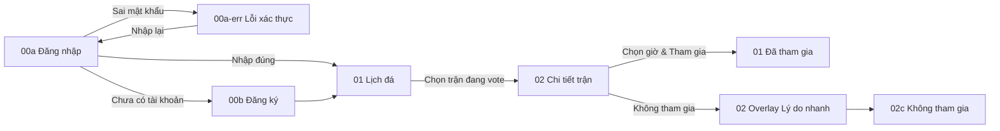
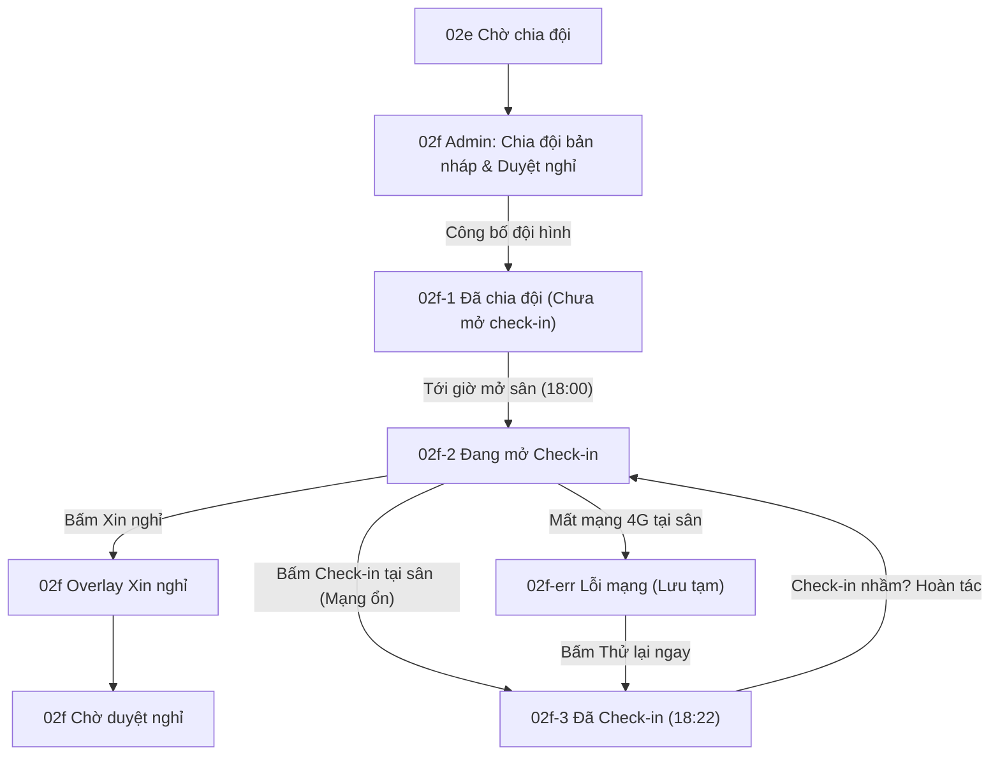
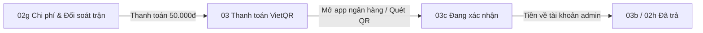

# Assignment 2 — Product Design, Prototyping & Validation

> **Liên kết nhanh:** [Trang chủ Wiki](Home) · [Figma Design](https://www.figma.com/design/fGXYmJMlxPStGfv1ouUuDe/Figma-HitDad?node-id=1-273) · [Interactive Prototype](https://www.figma.com/proto/fGXYmJMlxPStGfv1ouUuDe/Figma-HitDad?node-id=1-274&scaling=scale-down&content-scaling=fixed&starting-point-node-id=1%3A274) · [Behance Case Study](https://www.behance.net/gallery/258941175/CSE-HitDad-Mobile-App-for-Football-Club-Coordination) · [Product Landing Page](https://cse-hitdad.vercel.app)

---

## Phần 1 · Product Refinement & MVP Alignment

### 1.1. Rà soát bài toán, đối tượng mục tiêu & UVP
- **Problem Statement:** Các câu lạc bộ bóng đá nội bộ (~30–38 thành viên) gặp tình trạng rời rạc xuyên suốt ba giai đoạn trận đấu:
  1. *Trước trận:* Poll bình chọn trên Messenger dễ trôi tin, chủ kèo phải đếm thủ công quân số tham gia và người báo bận.
  2. *Tại sân:* Điểm danh và chia đội cho cân bằng trình độ + thủ môn mất 15–20 phút đầu giờ; xử lý người xin nghỉ sát giờ gây rối đội hình.
  3. *Sau trận:* Chia tiền sân, nước, áo bib dễ nhầm theo số người đi thực tế và chủ kèo ngại nhắc chuyển khoản từng thành viên.
- **Target Users:**
  1. **Chủ kèo / Ban cán sự CLB (Organizer/Admin):** Tạo kèo, chốt giờ, sắp đội hình, duyệt xin nghỉ và đối soát thanh toán.
  2. **Thành viên CLB (Player/Member):** Sinh viên và cựu sinh viên tham gia đá giao lưu định kỳ hàng tuần.
- **Unique Value Proposition (UVP):** Khép kín vòng đời một trận đấu bóng đá CLB (*Vote khung giờ → Chia đội cân bằng → Check-in tại sân → Chốt bill VietQR*) ngay trên di động với thao tác ngắn gọn, giảm gõ phím khi di chuyển và ngoài sân bóng.

### 1.2. Bảng đối chiếu nhất quán MVP (`F1–F6` từ ASS1) ↔ User Flows ↔ Figma Screens

| MVP Feature (theo `10-MVP-Scope`) | Updated User Flow (Figma) | Màn hình đại diện trên Figma | Trạng thái hỗ trợ |
| :--- | :--- | :--- | :--- |
| **Tiền điều kiện · Đăng nhập & Hồ sơ CLB** *(từ `12-Critical-User-Flows`)* | Flow 1: Đăng nhập & Xác thực · Flow 5: CLB & Tài khoản | `00a Đăng nhập`, `00b Đăng ký tài khoản`, `00a-err`, `04 Thành viên CLB`, `05 Tài khoản` | Default, Active, Input Validation Error |
| **F1 · Lịch và phản hồi** | Flow 2: Lịch đá, Tạo kèo & Bình chọn giờ | `01 Lịch đá`, `01 Tab Đã đá`, `02 Chi tiết trận`, `02 Overlay – Lý do không tham gia`, `02c Không tham gia`, `06 Tạo trận đấu – Admin` | Default, Voting, Closed, Quick-Select Chips, Empty |
| **F2 · Thông báo** | Flow 5: Quản lý CLB & Thông báo | `01 Lịch đá – Thông báo đẩy`, `09 Thông báo`, `09b Trạng thái trống` | Unread List, Push Preview, Empty State (`0 chưa đọc`) |
| **F3 · Điểm danh** | Flow 3: Check-in tại sân & Khôi phục lỗi | `02f-1` (Chưa mở), `02f-2 Đang mở Check-in`, `02f-3 Đã Check-in (Hoàn tác)`, `02f-err Lỗi mạng` | Disabled, Active, Success + Undo, Offline Recovery |
| **F4 · Chia đội** *(dùng `Tier S/A/B/C/D/Mới` & Thủ môn)* | Flow 3: Chia đội, Xin nghỉ & Check-in | `02e Chờ chia đội`, `02f Admin – Chia đội (chưa công bố)`, `02f-1 Đã chia đội`, `02f Overlay – Xin nghỉ`, `02f Chờ duyệt nghỉ` | Waiting, Draft (Admin), Published, Pending Leave Approval |
| **F5 · Chia tiền và QR** | Flow 4: Chốt bill & Thanh toán VietQR | `02g Đã đá – Chờ thanh toán`, `03 Thanh toán VietQR` | Cost Breakdown, VietQR & Copy Reference |
| **F6 · Trạng thái tiền** | Flow 4: Chốt bill & Thanh toán VietQR | `03 Thanh toán VietQR`, `03c Đang xác nhận`, `03b Đã trả`, `02h Đã đá, đã trả` | Pending Payment, Verifying, Confirmed/Paid |

### 1.3. Sơ đồ User Flows cập nhật (Đồng bộ với Figma Prototype)

#### Flow 1 & 2 — Đăng nhập, Lịch đá & Bình chọn khung giờ

#### Flow 3 — Chia đội bản nháp, Xin nghỉ & Check-in tại sân (Có xử lý lỗi mạng)

#### Flow 4 — Chốt chi phí & Thanh toán VietQR

### 1.4. Giải thích các thay đổi quan trọng so với Assignment 1 (Justification of Significant Changes)

1. **Bổ sung cơ chế Bản nháp chia đội cho Admin (`02f Admin`) và luồng Xin nghỉ sau khi chia đội (`02f Overlay – Xin nghỉ`, `02f Chờ duyệt nghỉ`):**
   - *Lý do:* Ở Assignment 1 ([12-Critical-User-Flows](12-Critical-User-Flows)), luồng chia đội được mô tả tuyến tính tại sân. Khi rà soát thực tế vận hành kèo, chủ kèo thường chia đội trước giờ bóng lăn để công bố trước cho anh em biết áo bib/thủ môn, nhưng vẫn phát sinh người xin nghỉ đột xuất. Việc tách trạng thái *Bản nháp* và *Yêu cầu xin nghỉ cần duyệt* giúp giữ nguyên sự rõ ràng về trách nhiệm tiền sân cho tới khi chủ kèo xác nhận người thay.
2. **Mở rộng thanh Check-in thành 4 trạng thái (`Chưa mở → Đang mở → Đã check-in có Hoàn tác → Đã khóa`) kèm màn hình Lỗi mạng (`02f-err`):**
   - *Lý do:* Sóng 4G tại nhiều sân bóng ngoài trời thường chập chờn và người dùng dễ bấm nhầm nút khi đang di chuyển. Bổ sung trạng thái tự check-in, `Hoàn tác` và `Offline Recovery (Thử lại ngay)` giúp đảm bảo dữ liệu điểm danh dùng làm căn cứ chia tiền sân không bị sai lệch.
3. **Thay thế việc gõ văn bản dài bằng Quick-Select Chips (`Bận học/thi`, `Ốm/chấn thương`, `Kẹt xe`, `Thời tiết xấu`):**
   - *Lý do:* Tuân thủ nguyên tắc thiết kế Mobile-First (giảm thiểu nhập liệu bàn phím). Thành viên chỉ cần 2 chạm để báo vắng thay vì bỏ qua không phản hồi.
4. **Tách rõ 3 trạng thái thanh toán VietQR (`Chưa trả` → `Đang xác nhận` → `Đã trả`):**
   - *Lý do:* Trong Assignment 1, nhóm đã nhận diện rủi ro nhầm lẫn giữa việc thành viên tự báo đã chuyển khoản và tiền thực sự về tài khoản chủ kèo. Màn hình `03c Đang xác nhận` thông báo rõ *"Đang chờ tiền về tài khoản admin — Thường mất dưới 1 phút"* giúp thành viên yên tâm thoát màn hình mà không chuyển khoản nhầm 2 lần.
5. **Cụ thể hóa tiền điều kiện Đăng nhập/Hồ sơ (`00a`, `00b`, `00a-err`, `04`, `05`) và bổ sung nhãn `Tier Mới` cạnh `S/A/B/C/D`:**
   - *Lý do:* Ở Assignment 1 ([12-Critical-User-Flows](12-Critical-User-Flows)), bước *"Đăng nhập và kiểm tra quyền"* được nêu như tiền điều kiện cho mọi luồng, còn bảng `F4` ([10-MVP-Scope](10-MVP-Scope)) mới liệt kê `Tier S/A/B/C/D`. Khi đưa vào thiết kế Figma, nhóm tách thành cụm màn hình đăng nhập/đăng ký, hồ sơ thành viên & tài khoản cá nhân để phân quyền rõ `Chủ kèo` vs `Thành viên`, đồng thời bổ sung nhãn `Mới` trong `HD/Tier badge` cho sinh viên mới vào CLB chưa kịp xếp hạng kỹ năng.

---

## Tài liệu Kết quả Kiểm thử (Tách riêng)

> Để tách bạch rõ **tài liệu giới thiệu sản phẩm/thiết kế trên Wiki** với **kết quả đánh giá người dùng của nhóm**, toàn bộ kịch bản kiểm thử (`UT-01` → `UT-04`), kết quả quan sát ẩn danh (`P01–P03`) và bảng so sánh cải tiến thiết kế (`Before → After`) được lưu tách riêng tại:
> - **[Báo cáo Usability Testing & Design Iteration (P01–P03)](https://github.com/HitDad/HitDad/blob/main/docs/ass2/usability-testing-report.md)**
> - **[Behance Case Study — Mục 08 & 09 (Tóm tắt kết quả test & Before → After)](https://www.behance.net/gallery/258941175/CSE-HitDad-Mobile-App-for-Football-Club-Coordination)**

---

## Phần 2 · Generative AI Usage Disclosure (Mục 6)

Trong quá trình thực hiện **Assignment 2 — Product Design, Prototyping, and Validation** cho dự án **CSE HitDad**, nhóm **L02_Hiền và nhiều tài** sử dụng công cụ AI tạo sinh làm trợ lý hỗ trợ theo đúng quy định liêm chính học thuật của học phần:

- **Các tác giả chính của bài tập lớn:** Toàn bộ ý tưởng sản phẩm, cấu trúc nghiệp vụ bóng đá câu lạc bộ (*Vote giờ → Chia đội Tier/Thủ môn → Check-in → VietQR*), dữ liệu thực tế của CLB CSE FC HCMUT, thiết kế giao diện Figma cốt lõi, nội dung tiếng Việt và kiểm thử người dùng (`P01–P03`) đều do 5 thành viên trong nhóm trực tiếp thực hiện, quyết định và chịu trách nhiệm.
- **Phạm vi sử dụng công cụ AI hỗ trợ:**
  1. **Rà soát bám sát Rubric & Kiểm tra thiếu sót:** Đối chiếu file thiết kế Figma với các tiêu chí của đề Assignment 2 để phát hiện các trạng thái tương tác còn thiếu (*Error/Validation, Offline Recovery, Empty State, Prototype Starting Points*).
  2. **Hỗ trợ kỹ thuật trên Figma & Web:** Hỗ trợ viết script plugin nội bộ (`HitDad BTL2 Finisher`) để tạo khung tổng hợp Design System, dựng các màn hình biến thể trạng thái từ component gốc của nhóm và nối dây tương tác Prototype; hỗ trợ dựng khung mã nguồn HTML/CSS cho **Product Landing Page** đồng bộ với bộ token màu sắc/chữ của Figma.
  3. **Biên tập cấu trúc tài liệu:** Hỗ trợ gợi ý dàn ý kịch bản kiểm thử Usability Testing, khung nội dung Case Study trên Behance và kiểm tra tính nhất quán giữa Wiki với thiết kế.
- **Quy trình kiểm duyệt của nhóm:** Tất cả đầu ra từ công cụ AI đều được thành viên nhóm rà soát thủ công trực tiếp trên trình soạn thảo Figma, trình duyệt web và kiểm thử lại các luồng tương tác trước khi xuất bản. Mọi thành viên trong nhóm đều nắm rõ lý do đằng sau từng quyết định thiết kế và có thể trình bày trực tiếp khi bảo vệ bài tập lớn.
